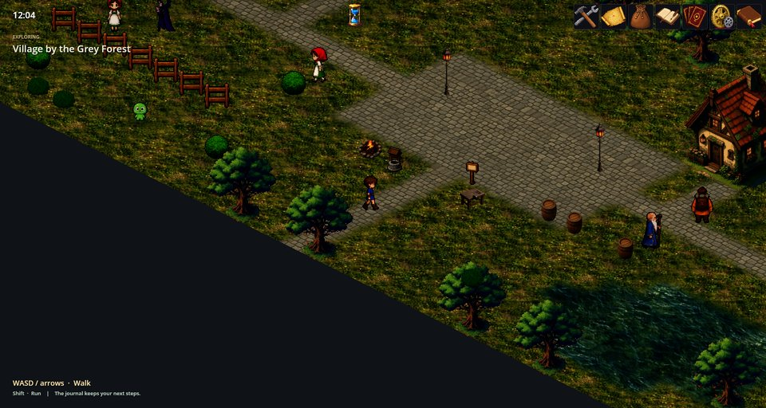
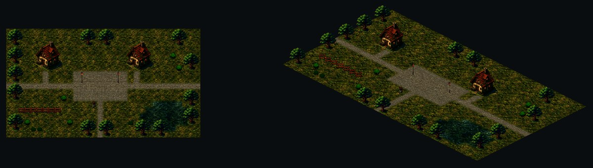

# Isometric Tiles — the diamond map view

Isometric Tiles draws tile maps at an angle, as a grid of 2:1 diamonds, so buildings and trees stand up out of the ground. It is one of two map views for the shared Tile Rendering engine; the other is Top-down Tiles. The same maps, events and saves work in both.



## What is different from the top-down view

- **Diamond cells.** Each map cell is drawn as a diamond twice as wide as it is tall. The logical grid is still square: a cell has the same four neighbours as before.
- **Standing objects.** Sprite `Parts` in `rpg_object` select `upright`, `ground`, `plane` or `quad` geometry; `Only` can restrict a part to one renderer. The same PNG can supply a whole top-down room and cropped isometric floor/wall faces.
- **Characters** pick the sprite row that matches their direction on the diamond grid.
- **Clicking** on the map selects the diamond under the pointer; the RPG map editor uses the same rule.



What does not change: walking rules, collisions, events, battles, saves, lighting and time of day are owned by the RPG mod and Tile Rendering and behave the same in both views.

## Limitations

- **Keys follow the grid, not the screen.** Up and down (W/S, arrows) move along one diagonal of the screen, left and right along the other, because they move the hero one cell on the square grid.
- **The edges of a map show.** Near a corner of the map you see the empty background beyond the diamond's edge, as in the picture above.
- **Prepare object geometry.** Define sprite parts and footprints in `rpg_object`; images alone do not specify wall planes, collision or sorting anchors.

## Turn it on

In the game's scheme (**Mods & Collections → Collections → the game → Edit scheme**), include this mod and set **Map projection** to **Isometric**. The value of the `tile.renderer` setting is `isometric`:

```json
"settings": { "tile.renderer": "isometric" }
```

To try it once without changing the game, start it with `--tile-renderer=isometric` on the command line. RPG Plus already includes both renderers, so only the setting needs to change.

## If something goes wrong

1. **The map is empty.** The game's **Map projection** asks for a renderer that is not included; include this mod or choose another projection.
2. **The hero walks diagonally.** That is how the keys work in this view (see Limitations).
