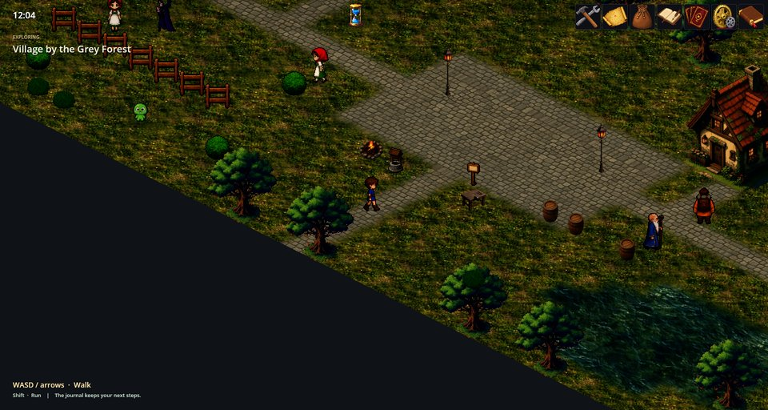
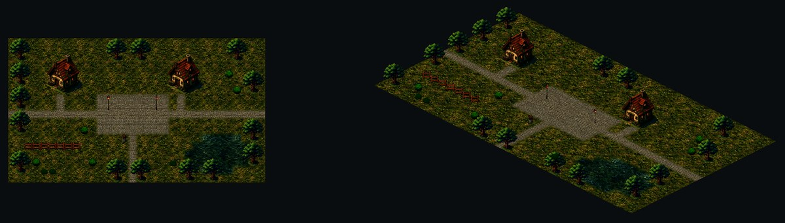

# Isometric Tiles — ひし形のマップビュー

Isometric Tiles はタイルマップを 2:1 のひし形の格子で斜めから描き、建物や木を地面から立ち上がらせます。共通エンジン Tile Rendering の 2 つのマップビューの 1 つで、もう 1 つは Top-down Tiles です。同じマップ、イベント、セーブがどちらでもそのまま動きます。



## 見下ろしビューとの違い

- **ひし形のマス。** 各マスは、高さの 2 倍の幅を持つひし形として描かれます。論理グリッドは相変わらず正方形で、マスの 4 つの隣接は昔のままです。
- **立つ物体。** タイルセットがそのように印をつけた建物などの複数マスの物体は、平たいタイルの代わりに、立ち上がった絵やいくつかの平面として描かれます。
- **キャラクター**は、ひし形グリッド上での向きに合うスプライトの列を選びます。
- **クリック**すると、ポインターの下のひし形が選ばれます。RPG マップエディターも同じ規則を使います。



変わらないもの: 歩行の規則、衝突、イベント、バトル、セーブ、照明、時間の流れは RPG Mod と Tile Rendering の持ち物で、両方のビューで同じように振る舞います。

## 制限

- **キーはグリッドに従い、画面には従いません。** 上と下（W/S、矢印）は画面の片方の対角線に沿って、左と右はもう片方に沿って動きます。正方形グリッドの 1 マスを動かすためです。
- **マップの縁が見えます。** マップの角の近くでは、ひし形の縁の向こうの空の背景が見えます。上の画像のとおりです。
- **タイルセットの準備が必要。** 物体が立って見えるのは、タイルセットがそれらをグループとして記述しているときだけです。普通のタイルはひし形の上に平たく置かれます。

## 有効にする

ゲームの構成（**MOD とコレクション → コレクション → ゲーム → 構成を編集**）でこの Mod を含め、**マップの投影**を **アイソメトリック** にします。設定 `tile.renderer` の値は `isometric` です。

```json
"settings": { "tile.renderer": "isometric" }
```

ゲームを変えずに 1 回だけ試すには、コマンドラインで `--tile-renderer=isometric` を付けて起動します。RPG Plus には両方のレンダラーが入っているので、設定だけ変えれば十分です。

## うまくいかないとき

1. **マップが空です。** ゲームの **マップの投影** が、含まれていないレンダラーを求めています。この Mod を含めるか、別の投影を選んでください。
2. **主人公が斜めに歩く。** このビューではキーがそう動く仕組みです（「制限」を参照）。
