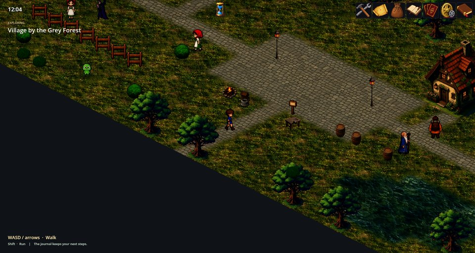

# Isometric Tiles — 마름모 맵 보기

Isometric Tiles는 타일 맵을 2:1 마름모 격자로 비스듬히 그려서 건물과 나무가 땅에서 솟아 보이게 합니다. 공유 엔진 Tile Rendering의 두 맵 보기 중 하나이며, 다른 하나는 Top-down Tiles입니다. 같은 맵, 이벤트, 저장이 양쪽에서 모두 작동합니다.



## 탑다운 보기와 다른 점

- **마름모 칸.** 맵의 각 칸은 높이의 두 배 폭을 가진 마름모로 그려집니다. 논리 격자는 여전히 정사각형이라 칸의 네 이웃도 예전과 같습니다.
- **입체 물체.** `rpg_object` 스프라이트의 `Parts`에서 `upright`, `ground`, `plane`, `quad`를 정하고 `Only`로 렌더러를 제한합니다. 같은 PNG를 탑다운 방 전체와 아이소메트릭 바닥·벽의 잘라낸 면에 쓸 수 있습니다.
- **캐릭터**는 마름모 격자에서 자기 방향에 맞는 스프라이트 줄을 고릅니다.
- **클릭**하면 포인터 아래의 마름모가 선택됩니다. RPG 맵 에디터도 같은 규칙을 씁니다.


바뀌지 않는 것: 걷기 규칙, 충돌, 이벤트, 전투, 저장, 조명, 시간대는 RPG 모드와 Tile Rendering의 소유이며 두 보기에서 똑같이 작동합니다.

## 한계

- **키는 화면이 아니라 격자를 따릅니다.** 위·아래(W/S, 방향키)는 화면의 한 대각선을 따라, 왼쪽·오른쪽은 다른 대각선을 따라 움직입니다. 정사각형 격자에서 한 칸을 움직이기 때문입니다.
- **맵 가장자리가 드러납니다.** 맵 구석 근처에서는 마름모 경계 너머의 빈 배경이 보입니다. 위 사진과 같습니다.
- **물체 기하를 준비하세요.** `rpg_object`에서 파트와 점유 영역을 정의합니다. 이미지만으로 벽면, 충돌, 정렬 기준점이 정해지지는 않습니다.

## 켜는 법

게임 구성(**모드 및 컬렉션 → 컬렉션 → 게임 → 구성 편집**)에 이 모드를 넣고 **지도 투영**을 **아이소메트릭**으로 정하세요. 설정 `tile.renderer`의 값은 `isometric`입니다.

```json
"settings": { "tile.renderer": "isometric" }
```

게임을 바꾸지 않고 한 번만 시도하려면 명령줄에서 `--tile-renderer=isometric`을 붙여 시작하세요. RPG Plus에는 두 렌더러가 이미 들어 있으므로 설정만 바꾸면 됩니다.

## 문제가 생겼을 때

1. **맵이 비어 있습니다.** 게임의 **지도 투영**이 포함되지 않은 렌더러를 요청합니다. 이 모드를 넣거나 다른 투영을 고르세요.
2. **주인공이 비스듬히 걷는다.** 이 보기에서는 키가 그렇게 작동합니다(한계 참조).
